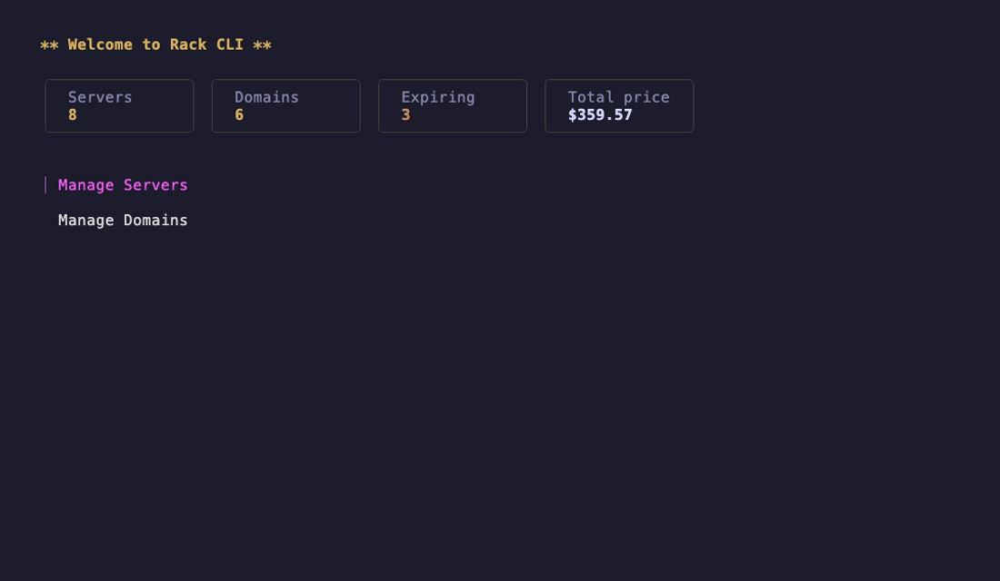

# rack-cli

A terminal app for tracking your servers and domains: credentials, prices, and expiry dates in one place.



## Installation

```sh
curl -fsSL https://raw.githubusercontent.com/omidnikrah/rack-cli/main/install.sh | bash
```

The script installs the latest release to `/usr/local/bin`, or `~/.local/bin` if that isn't writable. It supports macOS and Linux on amd64 and arm64.

## Usage

```sh
rack-cli
```

Press `?` inside the app to see the keys available on the current screen.

| Key            | Action                                   |
| -------------- | ---------------------------------------- |
| `a` / `e` / `d`| Add / edit / delete                      |
| `/`            | Filter the list                          |
| `p`            | Ping the selected server                 |
| `s`            | Open an SSH session                      |
| `space`        | Reveal the password                      |
| `c`            | Copy the password to the clipboard       |
| `esc`          | Go back                                  |
| `q`            | Quit                                     |

## Expiry notifications

```sh
rack-cli --check            # list items expiring within 7 days and send a notification
rack-cli --enable-notify    # run the check daily at 09:00
```

Notifications only work on macOS.

## Data storage

Data is stored as JSON in the user config directory (`~/Library/Application Support/rack-cli` on macOS, `~/.config/rack-cli` on Linux), accessible only by the current user.

Server passwords are encrypted with AES-256-GCM. The encryption key is kept in the OS keychain; if it is lost, saved passwords cannot be recovered. All other fields, such as IP addresses and labels, are stored unencrypted. A copied password stays on the clipboard for 30 seconds.

## License

[MIT](LICENSE)
